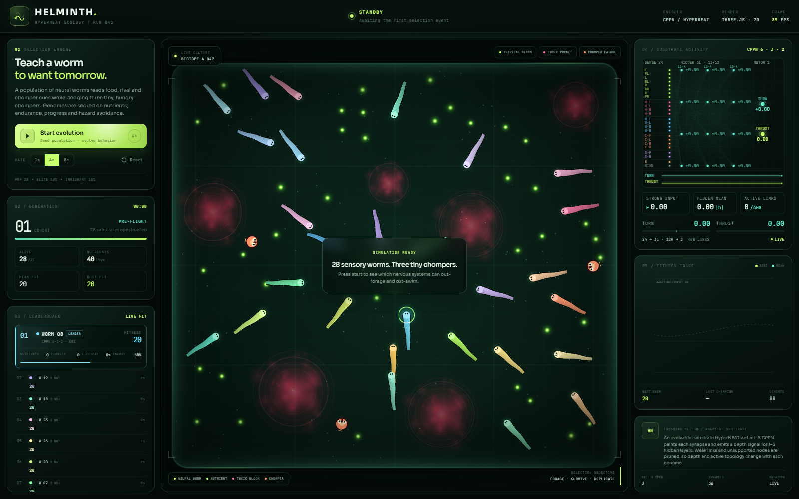
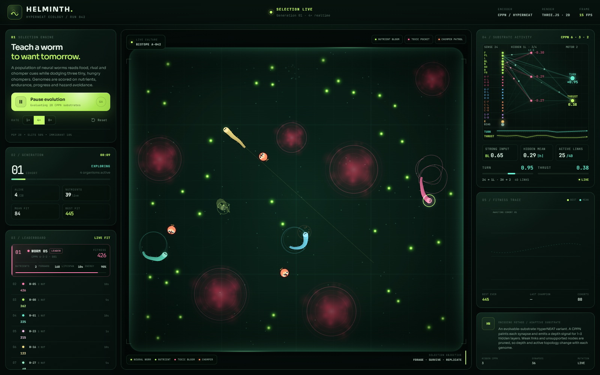
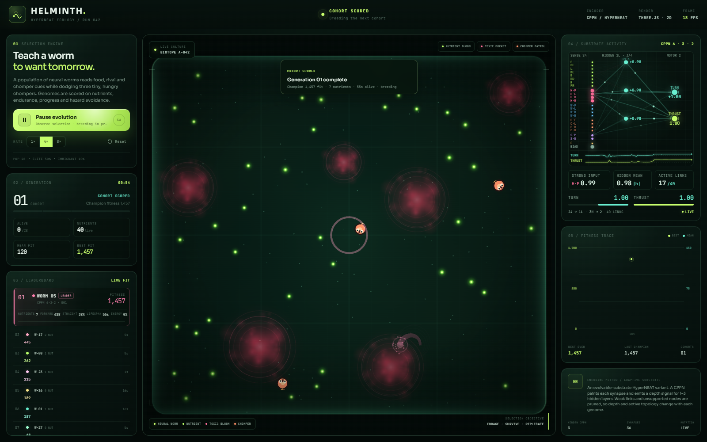
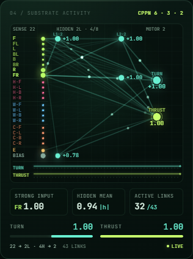

# HELMINTH

**An evolvable-substrate HyperNEAT ecology for worms that forage, sense rivals, and flee chompers.**

HELMINTH is a browser-native 2D artificial-life experiment. A population of 10 neural worms is scored on nutrient intake, survival, straight-line travel, net forward progress, and hazard avoidance. Each worm's brain is a neural substrate painted by a CPPN, and the substrate's hidden depth evolves alongside its connection weights. Three small chompers patrol the arena, turning the food race into a game of risk.

<p align="center">
  
</p>

## Highlights

- **Evolvable-substrate HyperNEAT** — 1–3 hidden layers, four candidate nodes per layer, CPPN-painted synapses, and pruning of weak or unsupported nodes.
- **24-channel sensorium** — 8 food rays, 4 hazard rays, 4 rival-worm rays, 4 chomper rays, 2 self-body rays, energy, and bias.
- **Body-aware worms** — 15-segment bodies, self-collision, worm-to-worm collision, wall response, and lethal energy loss.
- **Chomper patrol** — three predators that wander, chase, lunge, bite, digest, and retreat.
- **Straight-line selection** — travel credit is weighted by directional consistency, and turning carries a cost, so circles stop paying.
- **Live neurotelemetry** — substrate graph, active links, hidden-layer depth, strongest sensor, motor outputs, straightness, fitness trace, and live ranking.
- **Evidence-based UI checks** — a Playwright assessment verifies the ecology, the 24-sensor contract, responsive layout, and the absence of page errors.

## Quick start

### Requirements

- Node.js `^20.19.0` or `>=22.12.0`
- A WebGL-capable browser

### Run locally

```bash
npm install
npm run dev -- --port 4173 --strictPort
```

Open <http://127.0.0.1:4173/>.

On Windows, `START.bat` installs dependencies if needed, starts the server on port 4173, and opens the browser.

### Production build

```bash
npm run build
npm run preview
```

### Run the visual assessment

```bash
npx playwright install chromium
npm run assess
```

The assessment builds the production bundle, starts a temporary static server, and captures screenshots to `assess/output/` (gitignored). The curated images in this README live in `docs/screenshots/`.

## Screenshots

| Selection live | Cohort scored |
| --- | --- |
|  |  |

<p align="center">
  
</p>

The substrate close-up shows the evolved topology in motion: food, hazard, rival, chomper, and self-body channels feed the hidden layers, while the readout reports `24 → 1L · 3H → 2` and `40 LINKS`.

## Arena

The arena is a fixed 1360×1240 field seeded identically every run, so a cohort's fitness is comparable to the one before it:

- **120 nutrient blooms** with a 3.8 s respawn, spread across the field;
- **6 toxic pockets** (radius 58–104) that drain energy and are placed clear of the spawns;
- **3 chompers** that patrol, chase, and bite;
- **10 worms** that start at random, evenly spaced positions — at least 150 units apart, clear of toxic pockets, and kept well away from chomper patrol routes.

That last point matters more than it looks. When worms were scattered across the whole arena, a single unchanged genome scored anywhere from 82 to 13,891 depending only on where it happened to start, and the arena was food-saturated at 40 blooms for 28 worms. The measured "best" was then the maximum of a noise distribution, and elitism re-rolled the dice every generation. Random-but-evenly-spaced starts, fewer worms, and more food turn the fitness trace back into a learning curve.

## How a generation works

1. **Sense.** Each living worm samples the 24-channel sensorium.
2. **Think.** The worm's substrate performs a forward pass and emits turn and thrust outputs.
3. **Move.** Steering, thrust, speed, body joints, wall contact, and energy drain update at a fixed 60 Hz simulation step.
4. **Interact.** Food is consumed, toxic blooms damage worms, worm bodies collide, and chompers bite.
5. **Score.** Fitness combines food, survival time, straight-line travel, net forward progress, remaining energy, hazard exposure, and a turning cost.
6. **Select.** The population is ranked; the top half is retained unchanged, the bottom half is cloned and mutated, and a 10% immigrant slice is replaced with fresh random CPPNs.

A generation ends when the last worm dies or after a 120-second cap, so a robust surviving cohort cannot stall evolution. The default population is 10 worms: the top 50% are kept as elites, the bottom 50% are mutated into the next cohort, and 10% are fresh random genomes. Worms start at random positions that are evenly spaced, clear of toxic pockets, and well away from the chompers, so cohort-to-cohort fitness differences reflect behaviour rather than luck of the draw. The UI also offers a 4×/8× fast-forward control.

## Does it actually learn?

Measured over 6 seeds × 40 generations, comparing the first and last 8 cohorts:

| Metric | First 8 | Last 8 | Change |
| --- | ---: | ---: | ---: |
| Arena best fitness | 2,282 | 3,942 | **+73%** |
| Arena mean fitness | 567 | 902 | **+59%** |
| Champion quality (solo) | 3,869 | 8,636 | **+123%** |

5 of 6 seeds improve on all three metrics.

The comparison that matters is against controls with the *selection signal removed* — same arena, same mutation, same immigration, but survival order shuffled (and a second variant with no elitism at all):

| Variant | Arena mean | Champion quality |
| --- | --- | --- |
| Real GA | 574 → **1,173** | 1,220 → **1,669** |
| Random-elite control | 443 → **310** | 833 → **514** |
| Pure random walk | 283 → **158** | 497 → **336** |

Both controls *decline* while the real GA climbs, so the gain comes from selection rather than from drift.

A single `fitness` number still carries real variance, because a worm's outcome depends on the trajectory it happens to take. The trace in the dashboard shows the cohort best as a saw-tooth around a rising trend; the mean line is the steadier signal, and the `STRAIGHT` percentage on the leader card reports how much of the champion's path was travelled in a straight line.

## Adaptive substrate

The CPPN is a small fixed-topology network (`6 → 3 → 2` in the UI). It is queried at coordinates for each possible synapse and for a separate depth signal. The depth signal selects 1, 2, or 3 hidden layers; four candidate nodes exist in each layer. The substrate is then pruned:

- connection weights below the expression threshold are discarded;
- a hidden node needs at least two incoming links and at least one outgoing link;
- active hidden layers must form a contiguous stack from layer 1;
- hidden-to-hidden links only point forward;
- inputs connect to hidden nodes and directly to motor outputs.

The result is a different active topology for each genome, shown live as `24 → nL · hH → 2`, with the number of active links and hidden mean activation.

## Sensorium

| Channel | Inputs | Range | What it measures |
| --- | ---: | ---: | --- |
| Food | 8 | 330 | Directional alignment and closeness to active nutrient blooms |
| Hazard | 4 | 260 | Toxic-pocket proximity, with stronger signal inside the bloom |
| Rival worm | 4 | 300 | Direction and closeness to the nearest point on another worm's body |
| Chomper | 4 | 300 | Direction and closeness to a chomper, boosted by chase excitement and active chomping |
| Self body | 2 | — | How tightly the head is folded against its own trailing segments, and which side that body lies on |
| Energy | 1 | — | Current energy normalized to maximum |
| Bias | 1 | — | Constant `1` |

Food uses eight rays around the heading. Hazard, rival, and chomper channels each use four rays. Rival sensing samples the nearest body segment rather than only the other worm's head, so body contact is represented too. The two self channels let a worm feel its own body: one reports how far the head has folded back onto its trailing segments, the other reports which side that body lies on, so a coil can be unwound before it becomes a lethal self-collision.

## Fitness

```text
fitness = max(0,
    foodEaten      × 180
  + age            × 6
  + straightTravel × 0.018
  + forwardProgress× 0.045
  + energy         × 0.35
  - hazardTime     × 3.5
  - radiansTurned  × 2.4
)
```

`forwardProgress` is the net displacement from the worm's spawn point, not total path length, so looping in place does not earn the forward reward. `radiansTurned` is the absolute accumulated steering rotation, so continuous circling carries a fitness cost. `straightTravel` is path length weighted by directional consistency: each step only earns travel credit in proportion to how straight the worm has been moving, so a straight sprint is worth far more per unit than a tight circle. Together these three terms make circling unprofitable — a worm that loops in place earns neither travel nor forward credit and pays for every radian it turns.

## Chompers

The three chompers are deliberately simple and readable:

- cruise toward a wandering target when no worm is nearby;
- lock onto the nearest living worm within 270 units;
- accelerate into a lunge inside roughly 42% of their sensing range;
- bite for 18 energy on contact, then digest and cool down;
- retreat briefly after a successful bite.

Their bodies, googly eyes, teeth, and `CHOMP!` bubbles are rendered in the Three.js arena. Chompers have their own sensor channel rather than being folded into generic hazard data.

## Project layout

```text
src/
  config.js            Simulation, fitness, predator, and sensor constants
  evolution.js         Population lifecycle, ranking, selection, breeding
  main.js              App loop, controls, debug hooks
  neat/
    cppn.js            CPPN genome, mutation, crossover, compilation
    hyperneat.js       Adaptive substrate construction and forward pass
  sim/
    worm.js            Sensors, substrate outputs, movement, energy, bites
    predators.js       Chomper pack, chase/lunge/chomp state machine
    ecology.js         Food, toxic blooms, hazard and spawn placement
    collisions.js      Worm body collisions and death resolution
    random.js          Seeded RNG and math helpers
  render/
    arena.js           Three.js arena, worm visuals, chomper visuals, effects
  ui/
    dashboard.js       Live telemetry, substrate graph, fitness trace
index.html             App shell and copy
START.bat              Windows one-click launcher
assess/                Playwright visual and behavioral assessment
```

## Verification

`npm run assess` currently passes **18/18** checks, including:

- WebGL arena geometry and visible motion;
- three active chompers;
- 24 sensors with food, hazard, worm, chomper, and self-body channels;
- cohort scoring and advancement to the next generation;
- generation termination on extinction or the 120-second cap;
- pause/resume behavior;
- rendered fitness trace;
- 1440×900 compact layout with no clipped panels or page overflow;
- no uncaught page errors.

## Notes and constraints

- The arena is a fixed, seeded field, so a run is reproducible: the same seed produces the same blooms, pockets, chomper routes, and starting positions.
- Mortality is real and lethal — worm-to-worm and self-collisions both kill — but with 10 worms the early cohorts are no longer wiped out by a spawn pile-up.
- There is no backend or persistence. Reset restarts the run from the configured seed.
- The simulation is tuned for desktop; the right-side telemetry panel is hidden below 1040 px.
- The assessment screenshots are generated artifacts. The checked-in `docs/screenshots/` copies are the stable README images.
